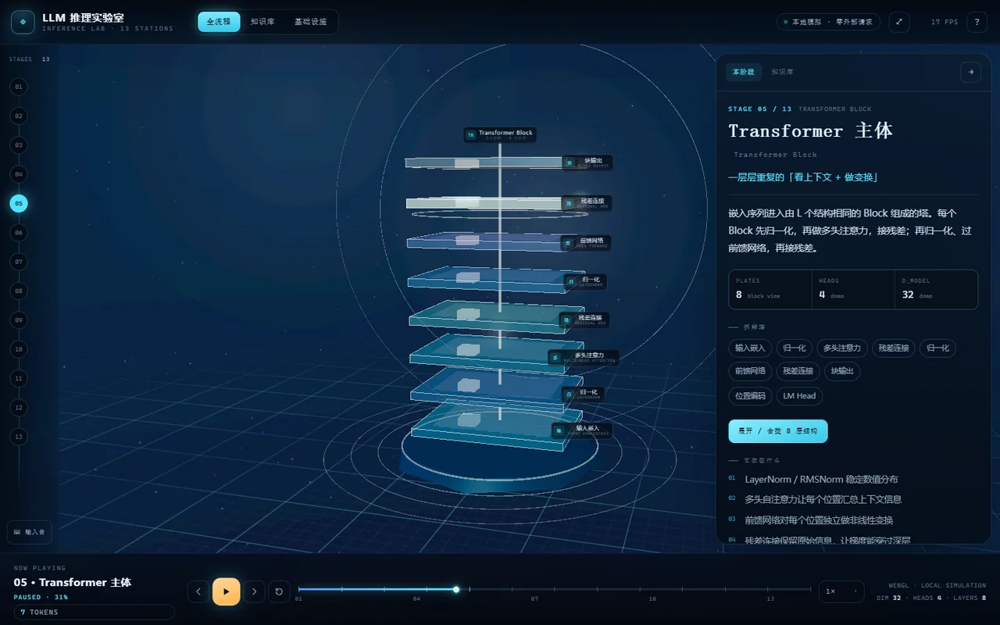

# LLM 推理实验室 · 3D 全流程

> 从用户输入到 AI 回答：把大语言模型的推理过程，做成一条可以走进去的 3D 流水线。

打开 [index.html](index.html) 即可。单文件、离线可用、零外部请求；Three.js、GSAP 与全部样式/脚本都已内联。



## 做了什么

- **13 站推理流水线**：用户输入 → 分词 → Embedding → 位置编码 → Transformer → 自注意力 → 多头注意力 → 深层堆叠 → LM Head / Logits → 采样 → 自回归生成 → 反分词 → 停止与返回。
- **真正的 3D 场景**：发光数据河、粒子流、站台光柱、Transformer Block 拆解塔、Q/K/V 三维注意力网络、Logits 柱状图、采样轮盘、KV Cache、EOS 门。
- **全流程自动播放**：开始/暂停、上一步/下一步、重播、0.5×–2× 速度、进度条与阶段讲解。
- **单模块探索**：点击任意站台或左侧编号，只保留当前模块并飞入镜头；Esc 或“全景”回到总览。
- **Transformer 深度拆解**：8 层结构可展开，点击层名或 HTML 标签查看对应概念。
- **注意力可交互**：本地计算因果注意力矩阵，点击任意 token 切换查询行，3D 连线随权重变化；面板同步显示热图。
- **采样沙盒**：温度、Top-K、Top-P 滑块会真实改变 softmax / 截断 / 采样结果，并同步到面板与场景。
- **实时输入台**：输入任意一句话，页面现场分词，并走完 13 站模拟推理；分词、注意力与采样为本地计算，回答是预置演示文案。
- **知识库**：62 个概念，10 个分组，覆盖输入上下文、分词、嵌入、位置编码、Transformer、注意力、采样、自回归、解码返回与推理基础设施。
- **基础设施岛**：GPU/CUDA、Tensor Core、VRAM、权重、量化、批处理、连续批处理、张量并行、流水线并行、分布式推理。

## 怎么开

```powershell
# 直接双击
index.html

# 或本地静态服务（可选，不是必需）
python -m http.server 8000
```

无需登录、无需后端、不靠 CDN。建议使用较新的 Chrome / Edge / Firefox / Safari（需要 WebGL 2）。没有 WebGL 时页面会给出明确提示，而不是静默白屏。

## 操作

| 操作 | 效果 |
| --- | --- |
| 拖拽 / 滚轮 / 右键拖拽 | 旋转 / 缩放 / 平移 3D 场景 |
| 点击站台或左侧编号 | 聚焦该阶段；编号栏可回到任意一步 |
| 点击 Transformer 层 | 展开拆解塔并打开该层知识点 |
| 点击注意力 token | 切换查询行 |
| 空格 / ← / → | 播放暂停 / 上一步 / 下一步 |
| Ctrl/⌘ + K | 打开知识库 |
| Esc | 关闭弹窗 / 输入台 / 原理面板 |
| 双击画布 / ⤢ 按钮 | 回到全景 |

## 演示边界（重要）

这是一个**原理演示**，不是真实模型监控台：

- 3D 粒子、矩阵数值、耗时与 token 计数均为示意；不代表任何真实模型的内部张量。
- 分词为近似演示：中文按常见词贪心合并、英文长词按 5 字符切分，Token ID 由文本哈希生成；**不是** GPT/LLaMA 的真实词表。
- 注意力权重与采样由浏览器本地的小规模数值真实计算，用于展示数学关系；维度与规模远小于真实模型。
- 固定演示回答与自定义输入的回答都是**预置文案**，本项目不调用任何模型 API。
- 内容以主流 decoder-only 模型为例，同时区分 Encoder-only、Encoder-Decoder、不同位置编码与归一化方案；训练与推理、logits 与概率、Tokenization 与 Embedding、KV Cache 与对话历史均分开表述。

## 构建与验收

```powershell
node tools/build.mjs   # dev.html + src/* → index.html（内联 CSS/JS/vendor）
node tools/qa.mjs      # 无头 Chrome：13 站遍历、播放推进、交互、移动端、截图
```

环境：Node.js 18+；本机 Chrome 或 Edge。QA 使用 SwiftShader 软件 WebGL，因此截图帧率只有约 17–35 FPS，真实 GPU 上会明显更高。

最近一次验收结果见 [qa/report.json](qa/report.json)：13 站全部可进入；`consoleErrors`、`failedRequests`、`pageErrors` 均为空；桌面与 390 px 移动端均无横向溢出；外部资源请求为 0。

## 目录结构

```
LLM执行流程/
├── 提示词.md              # 许愿原文（只读）
├── README.md              # 本文件
├── dev.html               # 开发入口，外链 src/ 下资源
├── index.html             # 构建产物，双击即开（禁止手改）
├── src/
│   ├── css/               # base / layout / panels
│   └── js/
│       ├── data.knowledge.js   # 62 条知识库（内容唯一来源）
│       ├── data.stages.js      # 13 站与演示文本
│       ├── core.js             # 纹理、缓动、工具
│       ├── mechanics.js        # 近似分词、注意力、softmax、采样
│       ├── scene.js            # 渲染器、相机、辉光、星空
│       ├── transformer.js      # 8 层拆解塔
│       ├── attention.js        # Q/K/V 与注意力网络
│       ├── infra.js            # 基础设施岛
│       ├── pipeline.js         # 13 站流水线与各站装置
│       ├── ui.js               # 面板、知识库、时间轴、输入台
│       ├── app.js              # 状态机与镜头调度
│       └── vendor/             # Three.js r147、GSAP 3.13 等（MIT）
├── tools/
│   ├── build.mjs
│   └── qa.mjs
├── research/
│   └── sources.md         # 技术口径与参考来源
└── qa/
    └── report.json        # 验收记录；截图由 QA 重新生成，不入库
```

## 依赖与许可

- [Three.js r147](https://threejs.org/)（MIT）：`src/js/vendor/three.min.js`、OrbitControls、EffectComposer、RenderPass、ShaderPass、UnrealBloomPass、CopyShader、LuminosityHighPassShader。
- [GSAP 3.13](https://gsap.com/)（GreenSock 标准许可，个人/非商业使用）：`src/js/vendor/gsap.min.js`。
- 界面、3D 场景、SVG 图标、文案与知识库均为本项目原创；第三方名称仅用于技术说明。
- 本项目为非商业学习/演示项目，不构成任何模型或厂商的官方说明。

## 参考

技术口径与参考链接整理在 [research/sources.md](research/sources.md)。关键参考包括 Attention Is All You Need (2017)、RoPE (2021)、ALiBi (2022)、GPT-3 / LLaMA 技术报告、vLLM PagedAttention 与 TensorRT-LLM 文档。
