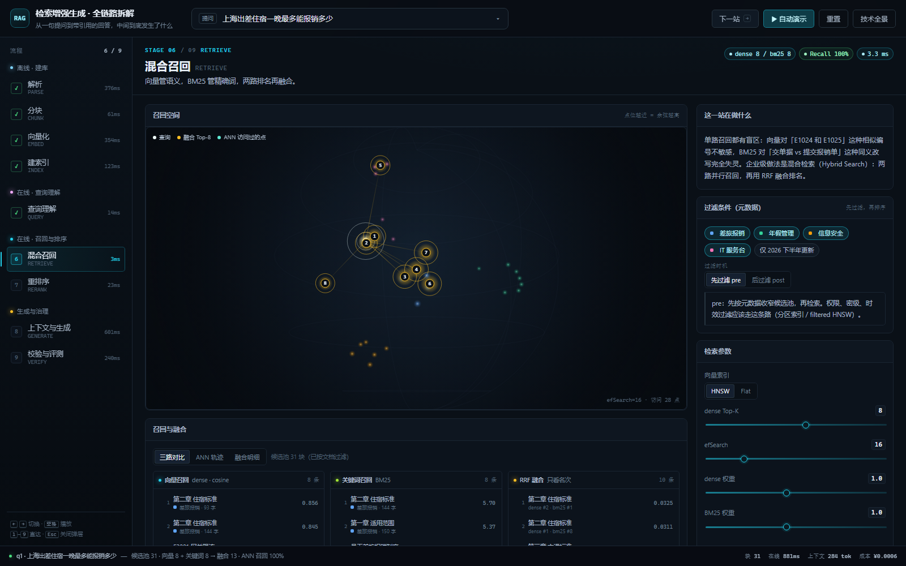

# RAG 全链路 · 交互式拆解

一个**单页、零依赖、可离线打开**的 RAG 讲解工具：从用户提问 → 解析 → 分块 → 向量化 → 索引 → 查询理解 → 混合召回 → ANN → 重排 → 上下文 → 生成 → 校验，每一站都能动手调参数、看真实数字变化。

配套的是同目录 `../rag/` 里的 8 个脚本实验。本页的语料直接取自 `rag/sample_docs/`（差旅报销、年假、信息安全），另外补了一篇 IT 故障码文档，专门用来演示「精确编号」检索。



## 想验证什么

1. **能不能用一个页面把 RAG 的完整链路讲清楚？**
   不是画一张静态流程图，而是每一站都有可交互的视图：分块地图、三维语义空间、HNSW 分层图、双路召回对比、重排前后名次变化、上下文预算、逐句引用校验。
2. **在真实的小语料上，能不能复现 `rag/` 的结论？**
   - 同义改写（「交单据」vs「提交报销单」）向量能召回、BM25 词面对不上；
   - 精确编号（E1024 / E1025 / E2024）BM25 一击即中，向量在相似编号之间摇摆；
   - 指标会饱和（R@5 三种配置都是 1.00），说明语料太简单。
3. **参数改了，结果是不是真的跟着变？**
   分块、BM25、RRF、HNSW 搜索、上下文组装、引用校验都是**真算的**。改 `chunk_size` 会真的重新切块；改 `efSearch` 会真的改变访问点数与 Recall@K；关掉 rerank 会真的换一批上下文。

## 怎么跑

直接双击 `index.html`，或：

```powershell
start .\rag-viz\index.html
```

- **不需要** `npm install`、不需要起服务、不需要联网。
- 浏览器：Chrome / Edge 现代版本（用到 `color-mix`、`ResizeObserver`、Canvas 2D）。
- 唯一用到的运行时能力是 Canvas 2D；三维空间是手写的投影 + 深度排序，不是 three.js（原因见「踩坑」）。

### 操作方式

| 操作 | 说明 |
|---|---|
| 顶部提问框 | 输入任意问题；也可以点右侧 `▾` 选 6 个预设问题 |
| `自动演示` / 空格 | 每 2.6 秒自动走到下一站 |
| `←` `→` / 左侧流程 | 单步前后切换；`1`–`9` 直接跳到某站 |
| 三维空间 | 拖拽旋转、滚轮缩放、悬停看点、点击选中 |
| 任意列表 / 引用编号 | 点击后联动到对应的块或上下文 |
| 过滤条件 | 文档 / 时效过滤，并切换 `pre-filter`（先过滤）与 `post-filter`（后过滤） |
| `技术全景` | 4 个阶段 × 32 项技术的清单，标注「可演示 / 仅说明」 |

### 可分享的参数链接

支持少量 URL 参数，方便直接打开某个状态：

```
index.html#retrieve?tab=ann&q=q4
index.html#chunk?strategy=recursive&size=350
index.html#generate?freeform=1
index.html#verify?threshold=0.1&q=q6
```

完整参数：`q`（预设问题）、`strategy` `size` `overlap`、`index`（hnsw/flat）`M`、`k` `sk` `ef` `ctx` `rrn`、`hybrid` `rerank`（0/1）、`rewrite` `multi` `hyde`（0/1）、`threshold` `freeform` `compress` `order`、`docs`、`fmode`（pre/post）、`tab`、`panel=panorama`。

## 结果如何

九站分别讲什么、这一页实际算出来的数字：

| # | 站点 | 这一站的产物 / 实测 |
|---|---|---|
| 1 | 解析 Parse | 4 份文档 → 77 段结构化文本，带来源 / 部门 / 版本 / 更新时间 / 密级 |
| 2 | 分块 Chunk | 默认 `chunk_size=200, overlap=40` → **31 块**，中位 104 字，元数据覆盖 100%；切到「纯递归」→ 元数据 **0%**，且平均实际重叠只有 1.4 字 |
| 3 | 向量化 Embed | 31 个向量（示意 64 维）；查询与 Top-1 的余弦 = 0.856 |
| 4 | 建索引 Index | HNSW：3 层 / 31 点 / 71 条边；也能看到向量库里一条记录的完整形态（id / 1024 维向量 / 原文 / 元数据 / ACL），以及 BM25 每个词元的 df 与 IDF |
| 5 | 查询理解 Query | 改写 / 多查询 / HyDE 三个开关，旁边直接对比改写前后的 Top-1 |
| 6 | 混合召回 Retrieve | dense 8 + BM25 8 → RRF 融合 13；ANN 访问 28 个点、Recall@8 = 100% |
| 7 | 重排 Rerank | 13 个候选 → 4 个上下文；Top-1 从 RRF 的 0.0325 变成 0.856，依据是「答案覆盖度 100%」 |
| 8 | 上下文与生成 Generate | 284 tokens 上下文，引用 [1]–[4]；裸模型模式会编出「500 元/晚」且没有引用 |
| 9 | 校验与评测 Verify | faithfulness 1.00；5 题评测：纯向量 R@1 0.80 → 混合+重排 1.00 |

几个特意做出来的对照：

- **q4「E1024 是什么错误」**：只看向量，Top-1 是 **E2024**（0.861），E1024 才 0.856；BM25 把 E1024 精确排到第一。这就是混合检索存在的理由。
- **q2「出差回来后最晚什么时候交单据」**：RRF 融合后 Top-1 是「第一章 适用范围」，正确答案在「第五章 报销流程」；重排把它拉回第一。
- **q6「公司年会在几月份」**：知识库里没有。阈值 0.45 时拒答；把阈值拖到 0.10，它会用「年假 15 天」那段硬答 —— 这就是拒答阈值的产品含义。
- **过滤时机**：只保留「年假管理」再问住宿问题。
  - `pre-filter`：先收窄到 7 块再检索，返回 7 条（语义分可能为负，因为确实不相关）；
  - `post-filter`：先在全库取 Top-8 再筛，**一条不剩**，Recall 0%。权限过滤如果写成 post-filter，就是这种事故。
- **「不加引用约束」**：模型照样能说出一段像模像样的假答案（500 元/晚），校验页会把它标成 unsupported。

## 踩了什么坑

1. **CDN 全部不可达**。本机 TLS 连接被拦，`three.js` 一个字节都下不来，所以三维空间用 Canvas 2D 手写了透视投影、深度排序、轨道旋转和命中测试。好处是页面零依赖、离线可开；代价是没有 bloom 之类的后期效果。
2. **CSS 自定义属性不能用 `Object.assign(style, obj)` 设**。`style["--c"] = "#f00"` 在浏览器里静默失败，导致分块颜色、泳道颜色、耗时瀑布颜色全变成默认色；必须 `style.setProperty("--c", ...)`。
3. **`h(tag, attrs, ...children)` 的第 4 个参数不一定是 opts**。我写卡片时把正文节点塞到了 `opts` 的位置，`opts.style` 拿到的是 `CSSStyleDeclaration`，`Object.assign` 直接抛 `Failed to set an indexed property [0]`，整页白屏。现在 `C.card()` 会把非 opts 的第 4、5… 个参数都当正文。
4. **HNSW 只连最近邻会把 4 个主题簇连成孤岛**，`M=6` 时 Recall 只有 0.3~0.7。改成标准的「多样性启发式」选边后才恢复 100%（`M=6` 也能跨簇）。
5. **无头 Chrome 在沙箱里起不来**（mojo 命名管道被拒），只能加宽权限后才拿到截图；`--dump-dom` 一直返回空，最后靠「把异常画进页面再截图」才定位到第 3 条。
6. **小库上 ANN 不占优**。31 个点时 HNSW 访问 28 个点，全扫描也才 31 次 —— 页面上如实写了「库太小，ANN 不一定快」，并用 efSearch 表展示趋势，不假装有百万级收益。
7. **本页的「向量」不是真 embedding**。见下一节，别把图上的距离当成 bge 的真实行为。

## 已知简化 / 失真

| 部分 | 本页做法 | 真实情况 |
|---|---|---|
| Embedding | 64 维「概念向量」+ 确定性噪声，PCA 降到 3 维 | `bge-large-zh-v1.5` 1024 维，语义由模型学出来 |
| 分块 | 复现了「标题感知 + 段落装箱 + 实际 overlap」的行为 | LangChain 实现细节更多（分隔符、长度函数、token 计数） |
| 分词 | 中文 bigram + 数字/编号正则 | `jieba.lcut` + 停用词（`rag/06`），或 ES 的 IK 分词 |
| HNSW | 一次性建全图 + 多样性启发式 + ef 提前终止 | 增量插入、删除标记、磁盘分层、多副本 |
| 重排 | 0.60×覆盖度 + 0.28×cosine + 0.12×字面 的演示打分器 | cross-encoder 把 query+chunk 拼起来过 Transformer |
| 生成 | 抽取式：只引用上下文里真实存在的句子 | LLM 组织语言，可能不忠实、可能编 |
| 耗时 / 成本 | 经验公式估算 | 与硬件、模型、批处理强相关 |
| 语料 | 4 篇（3 篇来自 `rag/sample_docs`，新增 1 篇 IT FAQ） | 企业里是成千上万篇，带权限与增量更新 |

**结论只在这些简化成立时有效**：方法之间的相对关系（混合检索 > 单路、重排能纠正 RRF、阈值决定拒答）可以参考；具体分数不要当成 bge 的实测值。

## 自测

```powershell
cd rag-viz
node selftest-engine.js   # 分块 / BM25 / HNSW / RRF / rerank / HNSW recall 的数字自检
node selftest-ui.js       # 用最小 DOM stub 跑完 9 站 + 6 个问题 + 交互回调
```

两个脚本都**不是**产品依赖，只是写这个页面时用来在没有浏览器的环境里抓运行时错误。

## 依赖

- 运行时：**无**。纯 HTML + CSS + 原生 JS，无 CDN、无框架、无构建步骤。
- 自测：Node.js（仅 `selftest-*.js` 用；不参与页面运行）。
- 浏览器：Chrome / Edge 111+（`color-mix`）、支持 Canvas 2D 与 `ResizeObserver`。

## 文件结构

```
rag-viz/
  index.html            页面骨架
  assets/
    theme.css           深色控制台主题 + 响应式
    data.js             角色：语料、6 个预设问题、概念标注、技术全景清单
    engine.js           分块 / BM25 / 64 维示意向量 / PCA / HNSW / RRF / rerank / 上下文 / 校验
    viz3d.js            Canvas 2D 手写三维空间（轨道、缩放、悬停、编号避让）
    ui-core.js          状态、导航、视图模型、页脚、弹层、URL 参数
    components.js       卡片 / 开关 / 滑杆 / 指标等部件
    stages-a.js         第 1~4 站
    stages-b.js         第 5~9 站
    app.js              启动入口
  selftest-engine.js    检索内核自检
  selftest-ui.js        DOM stub 冒烟测试
```

## 和 `rag/` 的关系

`rag/` 是「用 Python + LangChain 把每个环节跑一遍、记录真实 API 结果」；本页是「把同一批语料和结论做成可交互的模型」，用来建立直觉。

建议顺序：先玩这一页（建立全局图景）→ 再跑 `rag/01`–`08`（看真实 API 输出与坑）→ 回到这一页调参数验证「为什么」。

`rag/` 里的具体结论（如 `chunk_size=800` 建不了库、BM25 全 0 分仍返回假 Top-1）在本页的「动手试试」和文案里都有对应位置。
